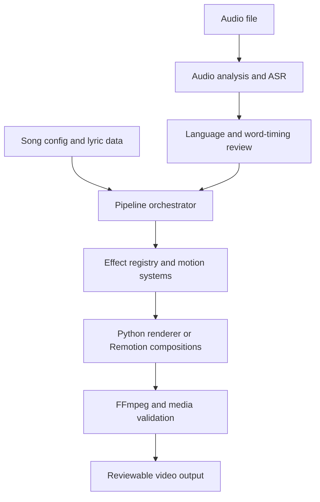

# VirtueMotif

[](https://github.com/virtuewise/virtuemotif/actions/workflows/ci.yml)
[](https://github.com/astral-sh/ruff)
[](#features)
[](https://virtuewise.github.io/virtuemotif/playground.html)
[](#the-horizon--live-remotion-test)

> An audio-reactive lyric-video and motion-typography engine, from multilingual lyrics to rendered film.

VirtueMotif synchronizes lyrics, language metadata, audio analysis, procedural visuals, and Remotion compositions. It includes a Python production pipeline and a React/TypeScript motion-design studio.

## Start here

| Destination | What it is | Open |
| --- | --- | --- |
| **Playground** | Play the Horizon test song, scrub its real lyric timeline, jump between sections, and watch the auto-preview in your browser. | [Open the live Playground](https://virtuewise.github.io/virtuemotif/playground.html) |
| **Playbook** | A practical path from setup to transcription, timing review, visual iteration, and final rendering. | [Open the Playbook](#playbook) |
| **The Horizon — live Remotion test** | Run the actual Horizon composition in Remotion Studio, or render a reproducible MP4 from the command line. | [Run the Horizon test](#the-horizon--live-remotion-test) |

### ASTRA-SH · The Horizon of Light (Tarisiro) — auto-preview

[](https://virtuewise.github.io/virtuemotif/playground.html)

<sub>Animated preview generated from the real `FurryHorizon` Remotion composition. Select the image to open the browser playground with song playback, lyric-synced seeking, section navigation, and the full timeline.</sub>

> **Two complementary test surfaces:** the hosted [Horizon browser playground](https://virtuewise.github.io/virtuemotif/playground.html) lets anyone test the song, lyric timeline, and section navigation without installing anything. The full Remotion Studio remains the editable local environment for changing compositions, props, and frame-level motion.

---

## Playground

The hosted [Horizon browser playground](https://virtuewise.github.io/virtuemotif/playground.html) is the zero-install test surface: it autoplays a muted Remotion preview, lets you play the Horizon recording, scrub the full song timeline, follow lyric changes, and jump between sections. The browser playground is built from the same `horizon.json` song data and audio asset used by the Remotion project.

For source-level experimentation, Remotion Studio gives you a live composition preview, timeline scrubbing, and composition selection while the code and song data remain editable in the repository.

### Launch Remotion Studio

Requirements: Node.js **24** and npm.

```bash
git clone https://github.com/virtuewise/virtuemotif.git
cd virtuemotif/film
npm ci
npm run studio
```

Remotion Studio opens in your browser. Select a composition from the composition list:

| Composition | What to explore |
| --- | --- |
| `FurryHorizon` | 3D fur-motion typography using the Horizon song data and `goldenHorizon` preset |
| `Horizon` | Classic 2D lyric-film composition |
| `SmartFurScene` | Audio-reactive 3D motion-typography scene |
| `SmartFurScene4K` | 3840 × 2160 output profile |
| `SmartFurSceneVertical` | 1080 × 1920 portrait profile |
| `SmartFurSceneSquare` | 1024 × 1024 square profile |
| `FurWaveSynth`, `NeonPulseCityscape`, `ParticleRainfall` | Individual visual systems and effect experiments |
| `AutoLyrics`, `AutoLyricsPortrait`, `AutoLyricsSquare`, `AutoLyrics4K` | Generic lyric compositions used by the auto-lyrics pipeline |

To experiment with a different lyric sequence, edit the song data in [`film/src/data/horizon.json`](film/src/data/horizon.json) or [`film/src/data/rise.json`](film/src/data/rise.json), then return to Studio. Keep word timings ordered and non-overlapping; the lyric export and render validators intentionally reject malformed timing.

### Where to change things

- Song content and timing: `film/src/data/*.json`
- Composition registration and dimensions: `film/src/Root.tsx`
- Main film components: `film/src/HorizonFilm.tsx`
- 3D scene components: `film/src/fur3d/`
- Typography and fitting utilities: `film/src/typography.ts`

---

## The Horizon — live Remotion test

The Horizon is registered as both the classic `Horizon` composition and the 3D `FurryHorizon` composition. The [hosted playground](https://virtuewise.github.io/virtuemotif/playground.html) is the fastest public test; the following commands run the full editable Remotion project with the included Horizon data.

### 1. Open the live preview

From the repository root:

```bash
cd film
npm ci
npm run studio
```

Choose **FurryHorizon** to inspect the 3D scene, or **Horizon** to inspect the classic film composition. Scrub the timeline to review lyric changes and transitions.

### 2. Render a Horizon MP4

From the `film/` directory:

```bash
npx remotion render src/index.ts FurryHorizon ../out/horizon-furry.mp4
```

For the classic 2D composition:

```bash
npx remotion render src/index.ts Horizon ../out/horizon-classic.mp4
```

### 3. Run the CI-style frame smoke test

This renders a still frame from the same composition registration used by CI:

```bash
npx remotion still src/index.ts FurryHorizon ../out/horizon-smoke.png --frame=0
```

The documentation deployment also renders a short `FurryHorizon` MP4/GIF preview from the registered composition and publishes the browser playground with the source song data and audio. The repository CI type-checks the Remotion project, validates composition registration, and captures visual-review frames for landscape, portrait, square, and 4K profiles. These automated checks establish that compositions load and render; they do **not** replace human review of the complete film, audio synchronization, typography, or media rights.

**Media rights:** use the included Horizon material as a development/test fixture only unless you have independently confirmed permission for the underlying composition, recording, performances, lyrics, and intended distribution. A successful render does not establish licensing or publication rights.

---

## Playbook

### 1. Set up the Python pipeline

Use Python **3.11**, FFmpeg, and ffprobe.

```bash
git clone https://github.com/virtuewise/virtuemotif.git
cd virtuemotif
python -m venv .venv
# Activate the environment, then:
python -m pip install --upgrade pip
python -m pip install -r requirements-dev.txt
ffmpeg -version
ffprobe -version
```

### 2. Generate a lyric video from a song configuration

Create or adapt a song configuration under `songs/`, then run:

```bash
python -m tools.make_video <song_id>
```

Rendered frames and the encoded MP4 are written under `out/`. Configuration examples and tool-specific options are documented in [`docs/tools/`](docs/tools/).

### 3. Generate lyrics automatically from audio

Install the optional ASR dependencies and the Remotion project dependencies:

```bash
python -m pip install "faster-whisper>=1.1" numpy soundfile
cd film && npm ci && cd ..
python -m tools.make_auto_lyrics_video "path/to/song.m4a" \
  --output out/song.mp4 --title "My Song" --artist "Artist"
```

The pipeline detects the language unless `--language` is supplied, probes the audio duration with ffprobe, and renders the generic `AutoLyrics` composition. Review the transcript, language labels, and word timings before publication. ASR output is a draft, not guaranteed ground truth.

See the [multilingual AutoLyrics guide](docs/multilingual-auto-lyrics.md) for language detection, timestamp validation, code-switch handling, and known limitations.

### 4. Correct timing with Tap-Sync

```bash
python -m tools.make_tapsync
```

Open the generated `timing/tap-sync-<song_id>.html` page and tap along with the audio to align lyric timing.

### 5. Inspect audio intelligence and visual behavior

- [Audio intelligence](docs/audio-intelligence.md): beat grid, energy contours, onset and transition cues.
- [Multilingual AutoLyrics](docs/multilingual-auto-lyrics.md): ASR, language metadata, timing, and review boundaries.
- [Architecture](docs/architecture.md): pipeline and data contracts.
- [Asset provenance](docs/assets-and-provenance.md): media source and rights status.

### 6. Validate before sharing a render

Run the relevant local checks:

```bash
python -m pytest -q
python -m tools.validate_language_dataset
cd film
npm ci
npx tsc --noEmit
npx remotion compositions src/index.ts
```

For a full release decision, follow the [release checklist](docs/release-checklist.md). Synthetic smoke fixtures and automated frame captures are engineering checks—not evidence of real-world multilingual accuracy or human visual approval.

---

## Architecture overview



## Features

- **Configuration-driven generation:** declarative song configuration combines audio sources, lyrics, style presets, and effect chains.
- **Extensible effect engine:** register custom visual effects in `tools/effects/`.
- **Multilingual AutoLyrics:** optional ASR with timestamped segments, word timings, language metadata, and JSONL streaming output.
- **Audio intelligence:** beat-grid estimation, energy contours, and timestamped onset/transition cues.
- **Motion typography:** classic 2D and GPU-accelerated 3D Remotion scenes, including landscape, portrait, square, and 4K compositions.
- **Timing and inspection:** Tap-Sync, frame validation, render benchmarks, and visual-review artifacts.
- **Unicode-aware text layout:** grapheme-aware fitting for multilingual text and complex glyph sequences.

## Repository map

```text
├── .github/workflows/    # CI, security, and release workflows
├── config/               # Default settings and global presets
├── docs/                 # Architecture, playbooks, governance, and tool guides
├── film/                 # Remotion React/TypeScript project
│   └── src/              # Compositions, data, typography, and 3D scenes
├── lyrics/               # Structured lyric transcriptions
├── songs/                # Song configuration files
├── timing/               # Lyric timestamps and Tap-Sync tools
└── tools/                # Python ASR, audio analysis, validation, and rendering
```

## Development environment

- Python **3.11** for the Python pipeline and tests.
- Node.js **24** and npm for the Remotion application in `film/`.
- FFmpeg and `ffprobe` for media decoding, encoding, and output validation.

See [Contributing](CONTRIBUTING.md) for reproducible setup and development practices. GitHub Actions runs the automated Python and Remotion validation workflows.

## Documentation and project links

- [Tool guides](docs/tools/)
- [Published API reference](https://virtuewise.github.io/virtuemotif/index.html)
- [Project management](docs/project-management.md)
- [GitHub Projects board](https://github.com/virtuewise/virtuemotif/projects)
- [Contributing guidelines](CONTRIBUTING.md)
- [Security policy](SECURITY.md)
- [Release checklist](docs/release-checklist.md)
- [Changelog](CHANGELOG.md)

## License status

The repository currently does not contain a root `LICENSE` file, so the project's license has not been verified from repository contents. Do not assume the project is available under MIT or another open-source license until the rights holder confirms the intended license and a matching license file is added.
