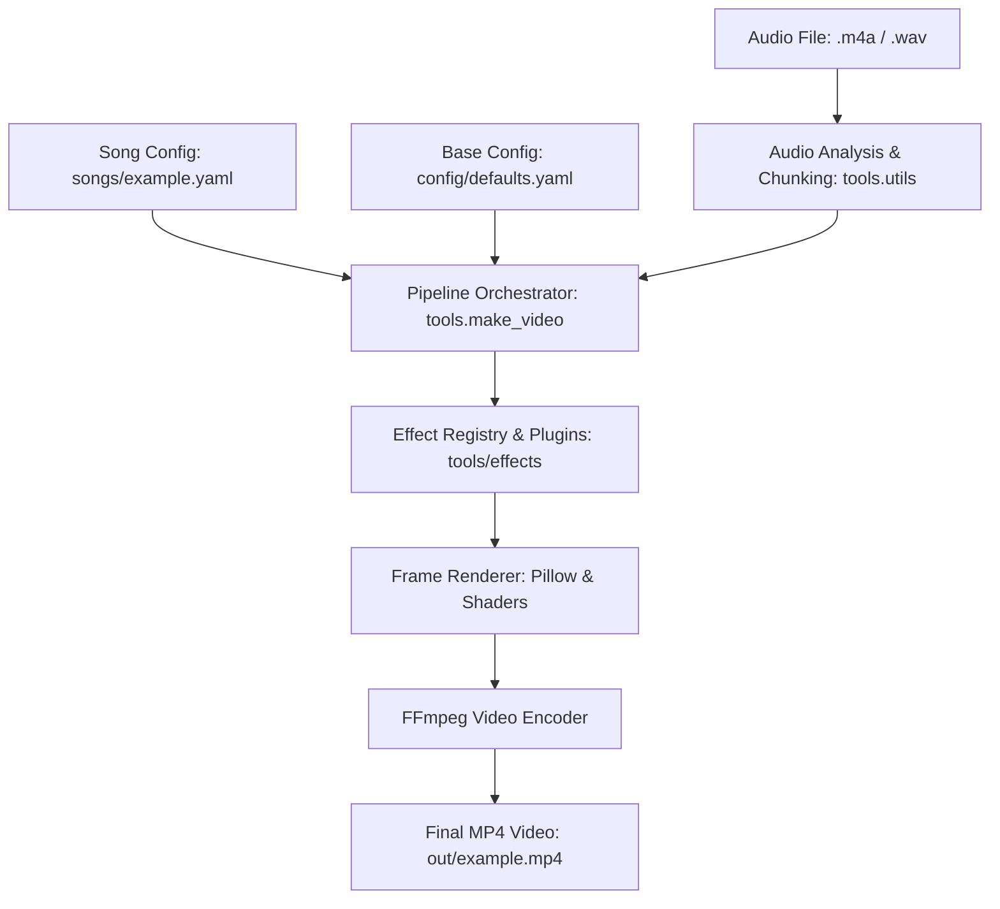

# virtuemotif

[](https://github.com/virtuewise/virtuemotif/actions/workflows/ci.yml)
[](https://github.com/astral-sh/ruff)

> Automated, audio-reactive lyric video rendering pipeline and motion typography engine.

**virtuemotif** is an extensible visual platform that synchronizes lyrical typography, procedural textures, and audio waveform analysis to produce production-grade lyric videos and motion graphic sequences.

---

## Architecture Overview



---

## Features

- **Configuration-Driven Generation**: Define songs in declarative YAML (`songs/<song_id>.yaml`) combining audio sources, lyrics, style presets, and effect chains.
- **Plug-and-Play Effect Engine**: Subclass `VisualEffect` in `tools/effects/` and register custom visual effects with arbitrary parameters.
- **Phoneme & Lyrical Alignment**: Automated speech-recognition (ASR) extraction, acoustic alignment, and manual tap-sync interface (`tools/make_tapsync.py`).
- **Procedural Texture Synthesis**: Dynamic film-grain, paper-fibre textures, and torn-paper alpha masks generated on-the-fly (`tools/make_textures.py`).
- **Remotion React Lyric Frontend**: Interactive web-based rendering environment in `film/` powered by Remotion, React, and TypeScript.
- **Inspection & Validation Suite**: Frame validation, RGB color balance checks, bounding box analysis, and audio stem correlation.
- **Comprehensive API Documentation**: Auto-generated documentation for the toolchain hosted under `site/`.

---

## Directory Structure

```text
├── .github/workflows/    # GitHub Actions CI workflow
├── config/               # Default settings & global presets
├── docs/                 # Architectural documentation & tool guides
│   └── tools/            # Markdown usage guides for every script
├── film/                 # Remotion React lyric video project
│   ├── public/           # Fonts, textures, and audio assets
│   └── src/              # React components (Backdrop, Type, HorizonFilm)
├── lyrics/               # Structured lyric transcriptions (JSON)
├── site/                 # API documentation landing pages and generated output
├── songs/                # Song configuration YAML files
├── timing/               # Lyrical timestamps, alignment data, and tap-sync tools
└── tools/                # Python audio analysis, effects & video pipeline
    ├── effects/          # Visual effect plugins & registry
    ├── make_video.py     # Main orchestration CLI
    └── utils.py          # Shared audio/frame helpers
```

---

## Quick Start

### 1. Installation

Clone the repository and install developer dependencies:

```bash
git clone https://github.com/virtuewise/virtuemotif.git
cd virtuemotif
python -m pip install -r requirements-dev.txt
```

### 2. Render a Video

Generate a lyric video using the orchestration pipeline:

```bash
python -m tools.make_video example
```

Output frames and the encoded MP4 video will be written to `out/example/` and `out/example.mp4`.

### 3. Generate Tap-Sync Timing Page

To interactively align lyrics by tapping along to the audio:

```bash
python -m tools.make_tapsync
```

Open `timing/tap-sync-<song_id>.html` in any modern web browser.

---

## Documentation

- **Tool Guides**: Browse comprehensive guides for each tool in [`docs/tools/`](docs/tools/).
- **API Reference**: Browse the [published API reference](https://virtuewise.github.io/virtuemotif/index.html). To build it locally, run `python -m pdoc -o build/api-docs tools`.
- **Project planning**: See [`docs/project-management.md`](docs/project-management.md) for the board workflow, saved-view design, priorities, and contribution standards. Open the [GitHub Projects page](https://github.com/virtuewise/virtuemotif/projects) to view the live board.
- **Contributing Guidelines**: See [`CONTRIBUTING.md`](CONTRIBUTING.md) for style and development practices.
- **Release History**: See [`CHANGELOG.md`](CHANGELOG.md).

---

## License status

The repository currently does not contain a root `LICENSE` file, so its license has not been verified from the repository contents. Do not assume the project is available under the MIT License until the rights holder confirms the intended license and a matching license file is added.
