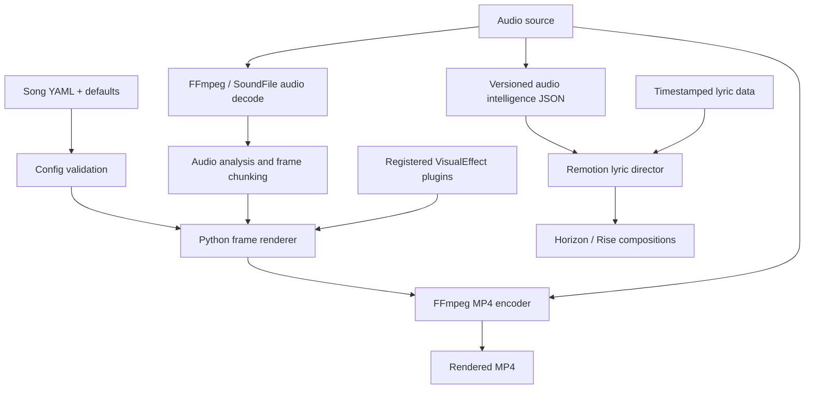

# Architecture and data contracts

VirtueMotif has two rendering paths that share media and timing inputs but have different runtime contracts.

## Pipeline boundaries

## Contracts

- **Song configuration**: YAML under `songs/` is merged over `config/defaults.yaml`. `tools.make_video.validate_render_config` validates the song ID, positive integer FPS, and positive integer dimensions before creating output directories.
- **Python audio input**: the renderer decodes source audio into mono floating-point samples and chunks them on frame boundaries. For (N) samples and FPS (f), chunk lengths are derived from integer sample boundaries so concatenating chunks preserves the original sample count.
- **Visual effects**: implementations registered in `tools.effects.EFFECT_REGISTRY` accept the current audio chunk and prior rendered frames and return a Pillow image matching the configured output size. Unknown effect names are currently skipped with a warning; if no valid effects remain, the renderer uses the waveform effect.
- **Frame and video output**: frames are named `frame_00000.png` and onward in a song-specific output directory. FFmpeg encodes them at the configured integer frame rate and dimensions. If an existing audio file is configured, it is muxed as AAC and the shorter stream determines the final duration.
- **Audio intelligence**: `tools.audio_intelligence.analyze_samples` emits schema-versioned JSON containing duration, sample rate, tempo/confidence, beats, downbeats, energy points, events, analysis metadata, and a review-required flag. Tempo and downbeat values are estimates, not authoritative transcription.
- **Remotion cue contract**: `film/src/fur3d/audioCues.ts` accepts schema version 1, validates bounded timestamps and normalized values, and maps a zero-based Remotion frame to cue time. Missing or invalid data selects deterministic fallback motion. Generated cue files are build outputs, not source-of-truth assets.

## Reproducibility and error handling

- Keep small synthetic WAV fixtures in tests rather than copying production songs into test fixtures.
- Keep rendered frames, encoded videos, build output, and generated cue JSON out of source control unless a specific reviewable artifact is required.
- Validate FFmpeg output with `ffprobe` in integration tests, including stream presence, dimensions, frame rate, frame count, and duration.
- Raise actionable errors for invalid render configuration and allow FFmpeg subprocess failures to surface; do not silently claim a video was created after a failed encode.

## Known boundaries

- The Python renderer and Remotion compositions are separate execution paths. A passing test of one does not validate the other; CI should retain checks for both.
- Audio-intelligence tempo, phase, and four-beat grouping are heuristic. Human review remains necessary for timing-critical releases.
- Asset provenance and redistribution rights must be documented separately; presence in the repository is not evidence of a license.

## Performance measurement

Run `python -m tools.benchmark_render` to create a deterministic synthetic-tone render and report the Python/platform/FFmpeg versions, render and encode times, process peak RSS, output size, frame count, and audio/video duration delta. CI runs a small configuration and uploads the JSON report for 14 days. Use the same parameters and runner class when comparing results; synthetic low-resolution timing is a regression signal, not a production-performance guarantee.
